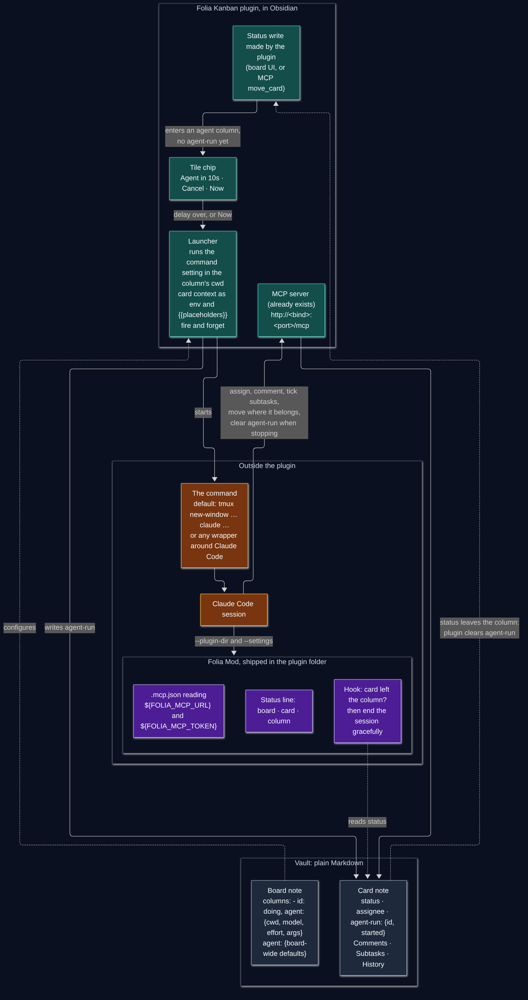

# Start an agent when a card enters a column

Decided on 2026-10-18. Issues #144 and #145, grouped under #143, follow this design. This is the agreed design; details it leaves open are free to decide, within these decisions.

Source: [design.mmd](design.mmd).

## What it does

A card dropped into a column that carries `agent:` starts an AI agent that works on that card and reports on the board the way a teammate would: it assigns itself, comments, ticks subtasks, moves the card where it belongs. Everything the agent writes goes through the plugin's existing MCP server, so it lands as signed comments, history lines and ordinary moves.

## Decisions

| Topic | Decision |
| --- | --- |
| What the plugin runs | One command, from a plugin setting, in the column's `cwd`. The card context travels as environment variables and as `{{placeholders}}` in the template. The plugin fires it and lets go. The process is not Obsidian's child, and the plugin keeps no handle to it. How and where the session is hosted is the command's business, not the plugin's. |
| Default command | A `tmux new-window -d … claude …` line, so the session has a terminal of its own and outlives Obsidian. Anyone can replace it with a command of their own. |
| Where it is declared | `agent: {cwd, model, effort, args}` as a key on a column object in the board note. A top-level `agent:` on the board note holds board-wide defaults. A card property may override. |
| What triggers it | A status write made by the plugin itself: a board UI move (drag, menu, detail panel) or an MCP `move_card`. A hand edit or a sync landing from another machine never launches, which is what stops a second machine from launching a duplicate. A card that already carries `agent-run` is never launched again. |
| Grace period | A chip on the tile, `Agent in 10s · Cancel · Now`. The delay is a plugin setting, 10 s by default, 0 disables the wait. Cancel, or the card leaving the column, aborts. |
| Run marker | `agent-run: {id, started}` in the card's frontmatter, written at launch. The plugin clears it whenever the card's status leaves the agent column, by anyone's hand. The agent clears it through `update_card` when it stops without moving the card. A marker left behind by a session closed by hand stays visible until the card is moved out of the column, which clears it; moving the card back in then launches again. |
| Folia Mod | A Claude Code plugin directory, called the Folia Mod here, shipped inside the Obsidian plugin folder so it is in the vault and reaches the agent wherever the vault is. It carries the project's name rather than one action's because more actions will live in it later. For now: the stop hook, a status line script, and the `.mcp.json`. |
| Stopping a running session | Pull only. The Folia Mod's hook reads the card file before each tool call and ends the session gracefully when `status` no longer names the agent column. |
| Finish | The agent decides where the card goes. The prompt template says so. No `then:` column. |
| Teammate depth | Run to completion and report on the card. No mid-run dialogue through comments in this cut. |
| MCP URL and token | The URL is `http://<bind address>:<port>/mcp`, built the way `docs/mcp.md` tells a client to, brackets around an IPv6 address included. An agent that is not on this computer is reached the way that page describes, by binding the server where the agent can see it. The token travels only as `FOLIA_MCP_TOKEN` in the command's environment, never on argv and never written to disk. |
| Survives Obsidian closing | Yes by construction, since the process belongs to the command, not to Obsidian. |

## What the Claude Code docs say about the mod

- A plugin directory cannot set `statusLine`; only `agent` and `subagentStatusLine` are honoured from a plugin's settings. The status line goes through `--settings '{"statusLine":{"type":"command","command":"<absolute path to the mod's script>"}}'`, which the default command template passes. Source: code.claude.com/docs/en/statusline, plugins/manifest-reference.
- A plugin's `.mcp.json` at the plugin root expands `${VAR}` in `url` and `headers`, so `"Authorization": "Bearer ${FOLIA_MCP_TOKEN}"` works and no `--mcp-config` is needed. Always set `"type": "http"`. Do not give the variable one of the credential names Claude Code blanks out in remote server config, such as `NPM_TOKEN`; the MCP docs list them. Source: docs/en/mcp#plugin-provided-mcp-servers.
- A `PreToolUse` or `PostToolUse` hook returning `{"continue": false, "stopReason": "…"}` stops Claude without killing the process. `${CLAUDE_PLUGIN_ROOT}` resolves inside a plugin's `hooks/hooks.json`. Source: docs/en/hooks#json-output.

## Context handed to the command

As environment variables, and as `{{camelCase}}` placeholders of the same names in the template:

`FOLIA_VAULT_PATH`, `FOLIA_BOARD` (vault path of the board note), `FOLIA_CARD` (vault path), `FOLIA_CARD_FILE` (absolute path), `FOLIA_CARD_SLUG`, `FOLIA_COLUMN`, `FOLIA_CWD`, `FOLIA_MODEL`, `FOLIA_EFFORT`, `FOLIA_ARGS`, `FOLIA_MCP_URL`, `FOLIA_MCP_TOKEN`, `FOLIA_MOD_DIR`, `FOLIA_RUN_ID`, `FOLIA_PROMPT`.

The prompt is a second setting, a template with the same placeholders, carrying the contract: assign yourself under your own name, comment when you start and at milestones, tick subtasks as you go, never edit card files directly, move the card where it belongs when done, and when you stop without moving it, say why in a comment and clear `agent-run`.
